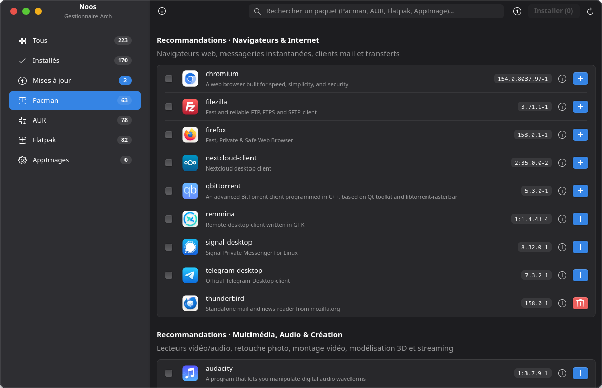
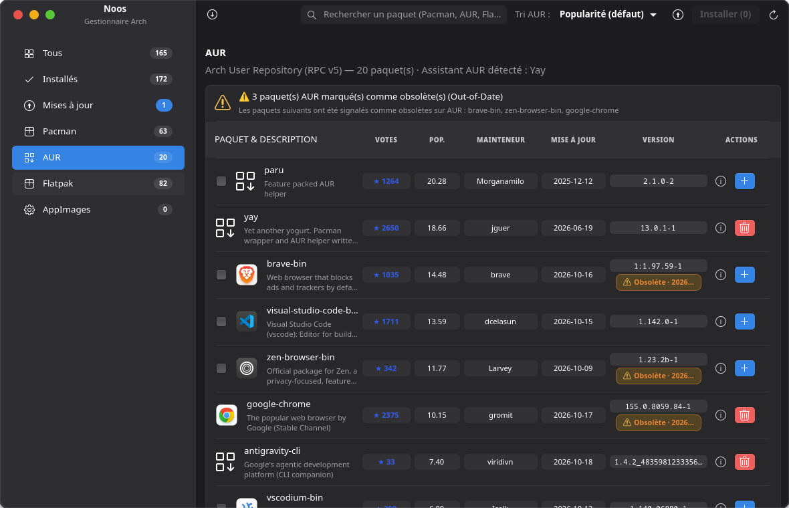
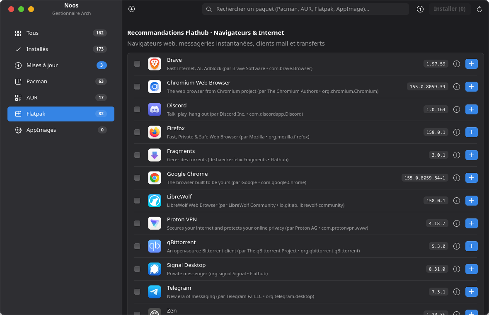
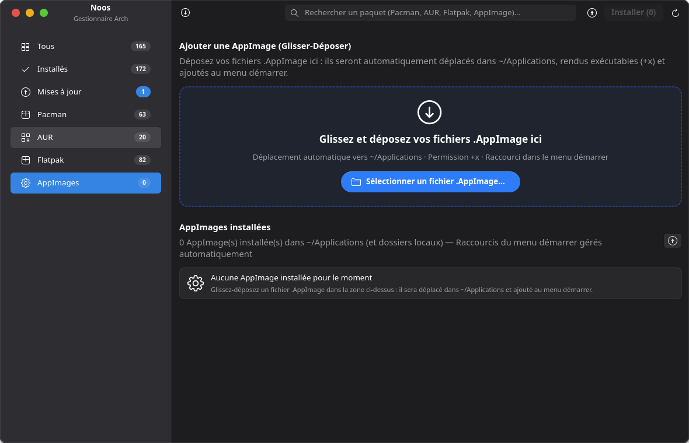
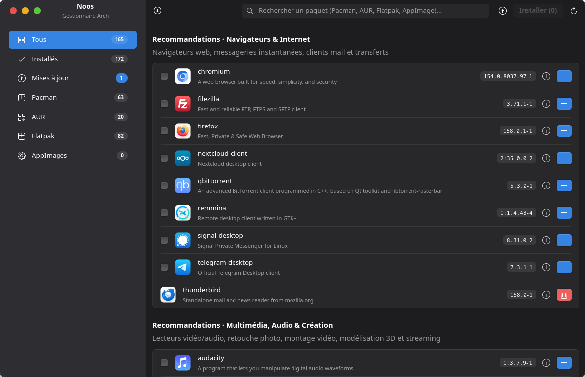

<p align="center">
  
</p>

<h1 align="center">Noos Package Manager</h1>

<p align="center">
  <strong>Le gestionnaire de paquets tout-en-un pour Arch Linux.</strong><br>
  Pacman, AUR, Flatpak et AppImages réunis dans une interface moderne, rapide et sécurisée.
</p>

<p align="center">
  <a href="https://github.com/Chomiam/noos-package-manager/actions/workflows/ci.yml"></a>
  <a href="https://scorecard.dev/viewer/?uri=github.com/Chomiam/noos-package-manager"></a>
  <a href="https://aur.archlinux.org/packages/noos-package-manager"></a>
  <a href="https://github.com/Chomiam/noos-package-manager/releases"></a>
  <a href="LICENSE"></a>
  <a href="SECURITY.md"></a>
</p>

---

## Une seule application pour tout votre système

Fini les allers-retours entre le terminal, les dépôts officiels et les outils AUR.
**Noos Package Manager** rassemble tout ce qui fait vivre votre Arch Linux dans une
interface unique, cohérente et agréable à utiliser :

- **Pacman** — paquets officiels, recommandations par catégories, logos natifs et
  réparation assistée des verrous de base de données.
- **AUR** — recherche, votes, popularité, mainteneurs, versions antérieures et
  installation directe via `yay`.
- **Flatpak / Flathub** — applications sandboxées, runtimes et mises à jour.
- **AppImages** — glisser-déposer, icônes, raccourcis du menu Démarrer et mises à
  jour GitHub.

## Ce qui fait la différence

### Tout au même endroit
Une seule liste, une seule recherche, un seul bouton **Installer** pour Pacman,
AUR, Flatpak et AppImages. Les mises à jour sont regroupées et traitées ensemble.

### AUR sans mauvaise surprise
Lorsqu'un PKGBUILD propose des variantes (GTK3 ou GTK4, plusieurs bibliothèques,
options de compilation), Noos Package Manager affiche une fenêtre claire avec
**une seule case à cocher par choix**. Les menus Yay de diff, d'édition ou de
confirmation sont neutralisés : vous ne voyez que les vraies options du paquet.

### Une interface qui vous ressemble
GTK4 et **libAdapta** pour une interface fluide, des thèmes clairs et sombres,
des icônes d'applications natives et un rendu soigné sur GNOME comme sur les
bureaux tiers.

### Des mises à jour sans effort
Un bouton **Tout mettre à jour** couvre Pacman, AUR, Flatpak et AppImages.
La CLI **`noos-up`** fait la même chose depuis un terminal, avec une interface
Ratatui colorée, une progression en direct et une seule authentification.

### La sécurité au sérieux
Chaque release est construite et contrôlée automatiquement : provenance
**SLSA Build L3**, **SBOM SPDX**, sommes **BLAKE2b** et vérifications de
durcissement. Les détails et les commandes de vérification sont dans
[SECURITY.md](SECURITY.md).

### Des détails qui comptent
- Cache local instantané et actualisation différentielle en arrière-plan.
- Notifications et journal interne pour retrouver chaque opération.
- Fiches détaillées avec README, liens officiels et métadonnées complètes.
- Mises à jour ignorées, historique des versions AUR et redémarrage des services
  après une mise à jour système.

## Aperçu

### Recommandations Pacman par catégories


### Catalogue AUR en colonnes


### Flatpak et Flathub


### AppImages par glisser-déposer


### Vue d'ensemble


## Installation

**Paquet AUR :** [aur.archlinux.org/packages/noos-package-manager](https://aur.archlinux.org/packages/noos-package-manager)

### Depuis l'AUR (recommandé)

```bash
yay -S noos-package-manager
```

Noos Package Manager est distribué comme paquet source : `yay` récupère les
sources, construit l'application et **libAdapta embarqué**. Aucune dépendance
AUR `libadapta` séparée n'est nécessaire.

### Depuis les sources

Prérequis (Arch Linux) :

```bash
yay -S --needed rust cargo gtk4 libadapta pacman-contrib flatpak polkit sudo reflector git
```

Puis :

```bash
git clone https://github.com/Chomiam/noos-package-manager.git
cd noos-package-manager
cargo build --release
./target/release/noos-package-manager
```

L'outil en ligne de commande est disponible dans le même dépôt :

```bash
noos-up          # vérifie et applique toutes les mises à jour
noos-up --check  # vérifie seulement
```

La construction directe avec Cargo utilise la bibliothèque système
`libadapta`. Le paquet AUR, lui, fournit libAdapta sous son nom d'origine. Sur
CachyOS, si l'installation de `libadapta` échoue dans ses tests, voir
[Dépannage](#dépannage).

### libAdapta embarqué

Le paquet AUR construit **libAdapta 1.5.0** depuis sa source officielle et
l'installe sous son nom d'origine `libadapta-1.so.0`. Il déclare
`provides=('libadapta=1.5.0')` et `conflicts=('libadapta')` : le paquet AUR
`libadapta` est remplacé par cette version identique, sans ses tests. Les autres
paquets qui dépendent de `libadapta` restent satisfaits par le `provides`.

libAdapta reste distribué sous **LGPL-2.1-or-later** ; sa licence est installée
dans `/usr/share/licenses/noos-package-manager/LICENSE-libadapta`.

## Dépannage

### CachyOS : `libadapta` échoue à l'installation (0.1.16 et antérieurs)

> Les versions **0.1.18 et ultérieures** fournissent libAdapta sous son nom
> d'origine et ne sont pas concernées. La procédure ci-dessous ne vaut que pour
> les versions antérieures.

CachyOS active `gtk-application-prefer-dark-theme` dans la configuration GTK.
Les tests de `libadapta` 1.5.0 traitent l'avertissement associé comme fatal et
`yay` s'arrête pendant `check()` :

```text
Bail out! Adapta-FATAL-WARNING: Using GtkSettings:gtk-application-prefer-dark-theme
with libadapta is unsupported. Please use AdapStyleManager:color-scheme instead.
```

La bibliothèque est compilée correctement ; seul le contrôle échoue. Installez
`libadapta` sans ses tests, puis l'application :

```bash
yay -S --mflags "--nocheck" libadapta
yay -S noos-package-manager
```

`--nocheck` ne s'applique qu'à `libadapta`. `needrestart`, autre dépendance,
s'installe normalement et n'est pas concerné.

## Premiers pas

1. Lancez **Noos Package Manager** depuis le menu Démarrer ou avec
   `noos-package-manager`.
2. Recherchez un paquet, ou explorez les recommandations par catégories.
3. Sélectionnez un ou plusieurs paquets, puis cliquez sur **Installer**.
4. Suivez la progression, les dépendances et les journaux dans le gestionnaire
   d'installation.
5. Pour les paquets AUR, choisissez les options du PKGBUILD dans la fenêtre
   dédiée : une seule case peut être cochée.
6. Utilisez **Mettre à jour** ou **Tout mettre à jour** pour garder le système à
   jour.

## Paramètres

La page **Paramètres** permet de régler l'application sans quitter l'interface :

- **Miroirs Pacman (Reflector)** : mesure des débits, tableau de 10 lignes
  défilable, application des meilleurs miroirs ou d'une sélection.
- **Cache Pacman** : taille utilisée et nettoyage avec `paccache`.
- **Pacman** : téléchargements parallèles (`ParallelDownloads`, de 1 à 20).
- **Yay** : compilation multi-cœur, compression des paquets et compilation en
  RAM. Les options de build PKGBUILD sont toujours interceptées.
- **Services système** : détection et redémarrage des services utilisant
  d'anciennes bibliothèques après une mise à jour.

Les préférences sont conservées dans
`~/.config/noos-package-manager/settings.json`.

## Sécurité et confiance

- Releases construites par **GitHub Actions** dans un environnement Arch épinglé.
- **Provenance SLSA Build L3** vérifiable avec `slsa-verifier`.
- **SBOM SPDX 2.3** attaché à chaque release.
- Sommes **BLAKE2b** dans le PKGBUILD de l'AUR et **SHA-256** pour les artefacts.
- **libAdapta 1.5.0 embarqué** (LGPL-2.1-or-later), installé sous son nom
  d'origine `libadapta-1.so.0` ; le paquet fournit `libadapta=1.5.0` et
  remplace le paquet AUR du même nom.
- Vérifications **namcap**, **checksec**, `cargo audit`, `cargo auditable`, **CodeQL** et **fuzzing** `cargo-fuzz`.
- Actions GitHub épinglées (SHA, sauf le générateur SLSA référencé par tag), Dependabot et **OpenSSF Scorecard**.

Les commandes de vérification (provenance, sommes, SBOM) sont détaillées dans
[SECURITY.md](SECURITY.md).

## Licence

Noos Package Manager est un logiciel libre distribué sous **GNU General Public
License v3.0 ou ultérieure**. Voir [LICENSE](LICENSE).

Le nom, le logo **Noos** et l'identité visuelle de l'application appartiennent à
leur auteur.
